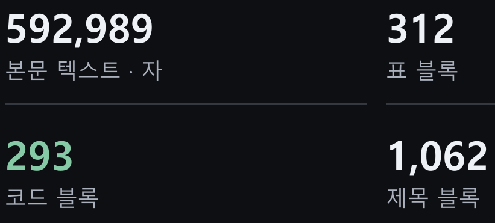
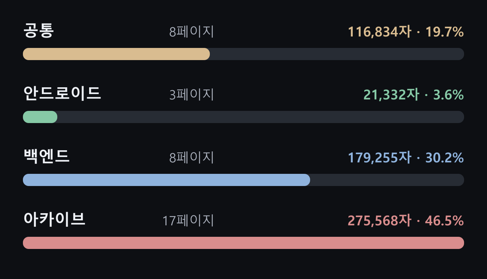
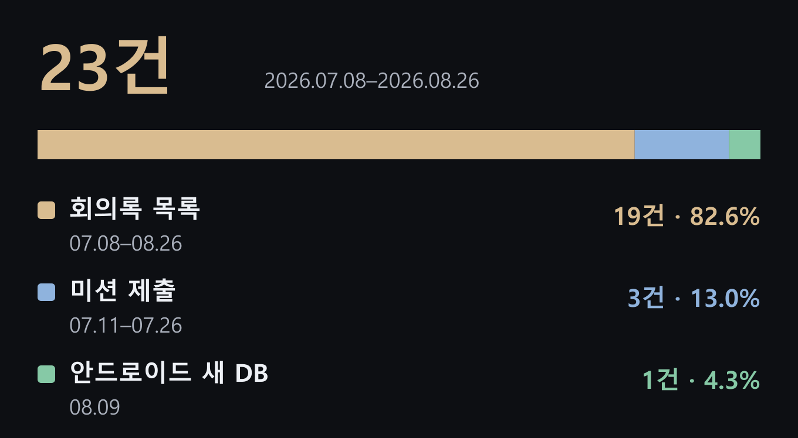
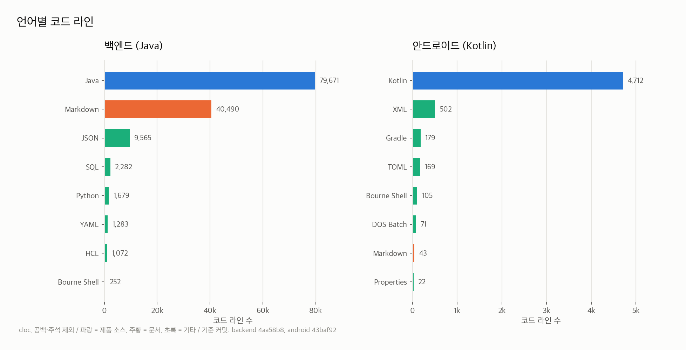
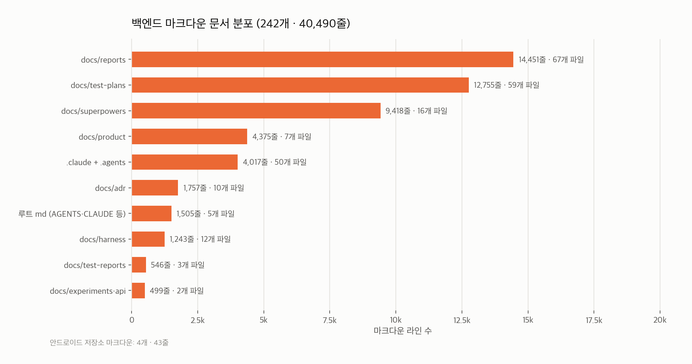
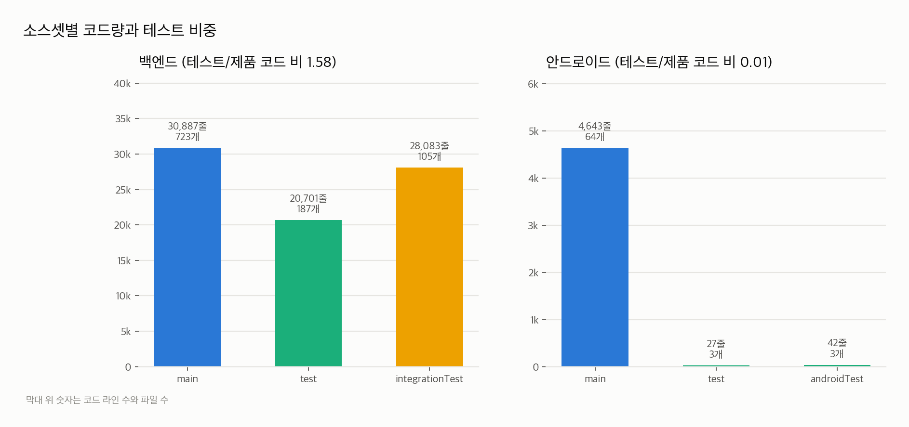
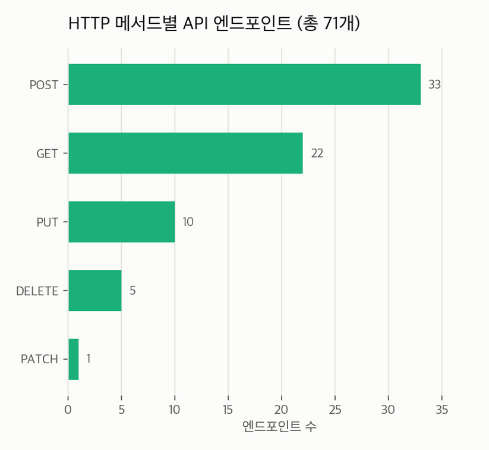
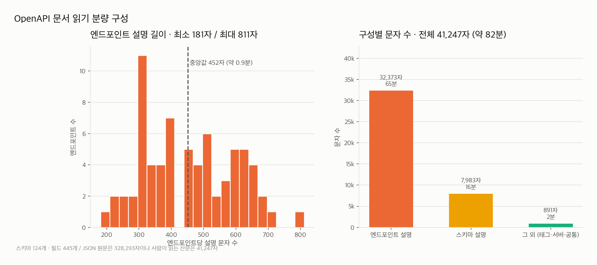
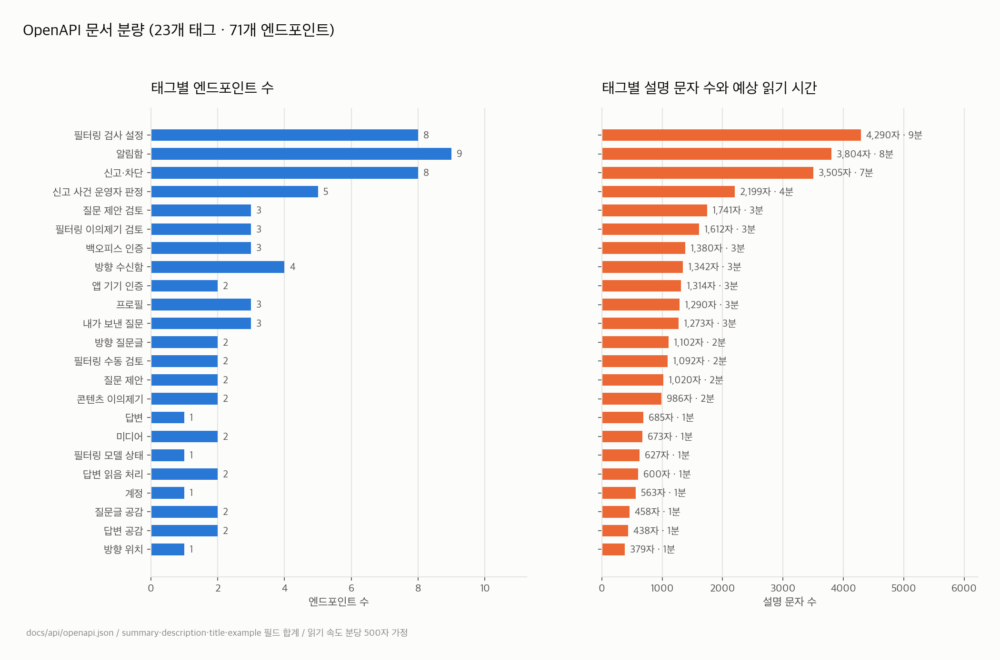
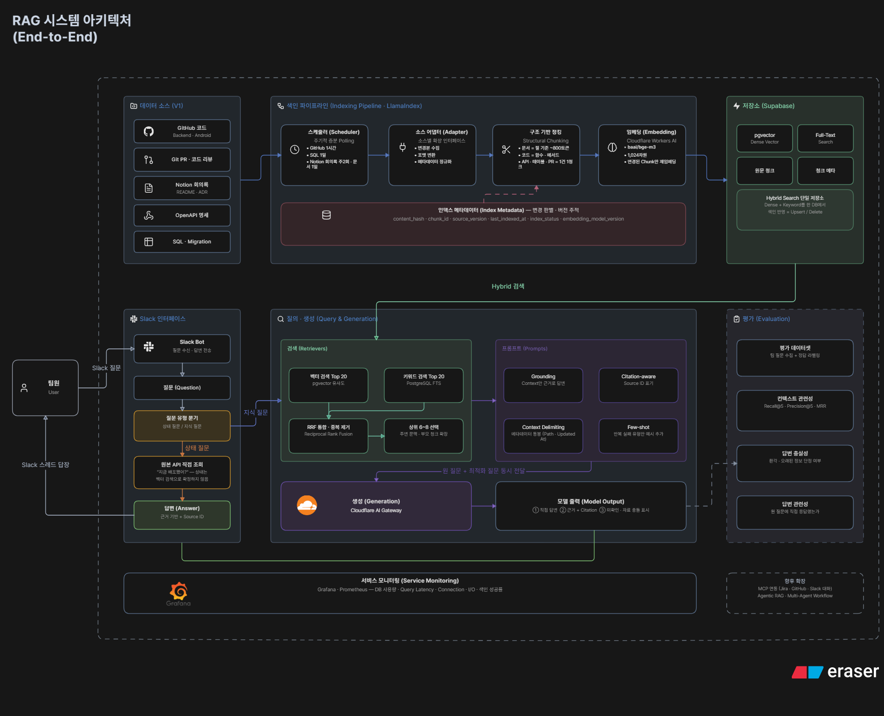

## 1. 개요

6월 이후로 오랜만에 글을 씁니다. 그사이 IT 동아리 [DND 15기](https://dnd.ac/)에 들어갔고, SSAFY 16기로도 입과했습니다. DND 활동은 8월 말에 끝났지만 저희 팀은 지금도 개발을 이어가고 있습니다. 실제로 운영할 수 있는 서비스까지 만들어보고 싶었습니다.

기획이 중간에 한 번 바뀌면서 개발에 쓸 수 있는 시간은 3주 정도밖에 남지 않았습니다. 당시 저는 `AI 에이전트`가 원하는 범위 안에서 안정적으로 코드를 작성하게 하려면 어떻게 해야 할지 관심이 많았습니다. 백엔드 팀원인 **성재님**도 비슷한 고민을 하고 있어서, 함께 **작업 규칙**과 **문서**를 갖춘 `하네스`를 만들었습니다. 기능을 구현하면서 에이전트가 참고할 문서도 조금씩 다듬었습니다.

그렇게 개발을 이어온 지 **두 달**이 넘었습니다. 매주 한 번씩, 보통 두 시간 정도 회의를 하는데 같은 내용을 다시 확인하는 일이 자주 생겼습니다.

> “프론트엔드의 OO 기능 어디까지 진행하셨나요?”  
> “저희 이 기능 빼기로 했던 거 아닌가요?”  
> “OO API 흐름이 어떻게 되는 거예요?”

회의록은 Notion에 꼬박꼬박 남기고 있습니다. 그런데 문서가 쌓이다 보니 결정 사항이 어느 회의록에 있는지부터 찾아야 했습니다. 현재 구현 상태가 궁금하면 코드와 PR도 살펴봐야 했고요. 질문 하나에 답하려고 지난 회의록을 몇 개씩 열어 보고, 그 내용과 지금의 코드를 대조하는 일이 반복됐습니다.

개발할 때는 이미 AI 에이전트를 쓰고 있습니다. MCP를 연결하면 Notion이나 GitHub 자료를 읽게 할 수도 있습니다. 하지만 **“이 기능 빼기로 했나?”** 라는 질문에는 관련 회의록을, **“어디까지 구현했나?”**라는 질문에는 코드와 PR을 찾아봐야 합니다. 기록마다 작성 시점도 달라서 현재 기준에 맞는 내용인지 확인해야 합니다. 저희에게는 질문에 맞는 기록을 찾고 출처를 확인하는 방법이 필요했습니다.

그래서 성재님과 저는 RAG를 만들어보기로 했습니다. 회의록과 개발 자료를 검색할 수 있게 정리하고, 질문이 들어오면 관련 내용을 찾아 출처와 함께 답하는 방식입니다. 팀원이 비슷한 질문을 할 때마다 누군가 회의록을 처음부터 다시 뒤지지 않아도 되게 하고 싶었습니다.

이번 글에는 저희가 어떤 자료를 RAG에 넣을지 살펴보고, 도구를 고르면서 무엇을 고민했는지 적어보려 합니다.

## 2. 배경

먼저 팀에 쌓인 자료를 하나씩 살펴봤습니다. 문서를 얼마나 자주 가져와야 할지, 어떤 임베딩 모델을 쓸지, 서버는 어느 정도 규모가 필요할지 판단하려면 자료의 종류와 양부터 알아야 했습니다.

회의에서 반복해서 나오는 질문을 묶어보니 지난 회의의 결정 사항, 백엔드와 안드로이드 코드의 흐름, API의 동작, 디자인 변경 내역으로 나뉘었습니다. 우선 회의록과 코드, API 명세를 살펴봤습니다. 디자인 변경 내역은 Figma MCP 연동과 문서화가 진행 중이라 나중에 추가하기로 했습니다.

### 1) Notion 팀 문서

#### 문서 전체 규모

Notion 문서의 본문 텍스트만 세어도 **592,989자**였습니다. 표 블록 312개, 코드 블록 293개도 따로 확인했습니다. 글의 양만 볼 게 아니라, 표와 코드처럼 형태가 다른 내용도 어떻게 가져올지 살펴봐야 했습니다.

#### 주제별 분포

본문 텍스트를 주제별로 나누니 아카이브가 **275,568자(46.5%)**로 가장 컸습니다. 백엔드는 179,255자(30.2%), 공통은 116,834자(19.7%), 안드로이드는 21,332자(3.6%)였습니다. 아카이브까지 검색 대상에 넣는다면, 지난 기록과 현재 쓰는 문서를 구분할 방법도 필요해 보였습니다.

#### 데이터베이스

Notion 데이터베이스는 **23개**였습니다. 회의록 목록이 19개로 대부분을 차지했고, 미션 제출 3개와 안드로이드 새 DB 1개가 있었습니다. 회의록 관련 데이터베이스만 해도 꽤 많았습니다.

### 2) GitHub 코드, PR, Issue

GitHub에서는 코드뿐 아니라 저장소에 쌓인 문서도 확인했습니다. PR과 Issue도 검색 후보에 넣었지만, 아래 그래프는 **저장소의 파일**을 집계한 결과입니다.

#### 코드와 문서의 양

백엔드에는 Java 코드 79,671줄과 Markdown 문서 40,490줄이 있었습니다. 안드로이드의 Kotlin 코드는 4,712줄이었습니다. 코드 흐름을 묻는 질문을 다루려면 저장소의 규모를 알아야 했고, 코드 외에도 살펴볼 문서가 꽤 있었습니다.

백엔드 Markdown 문서는 **242개**였습니다. 특히 `docs/reports`와 `docs/test-plans`에 문서가 많이 모여 있었습니다. 개발 중 남긴 설명과 테스트 계획이 코드와 함께 저장돼 있다는 점을 확인했습니다.

#### 테스트 코드의 비중

백엔드는 제품 코드 30,887줄에 테스트 코드와 통합 테스트 코드가 합쳐서 48,784줄이었습니다. 반면 안드로이드는 제품 코드 4,643줄에 테스트 코드가 69줄이었습니다. 저장소마다 코드의 구성이 달라서, 검색 범위를 정할 때 테스트 코드를 어떻게 다룰지도 따져봐야 했습니다.

### 3) API 명세

API 명세에는 **71개 엔드포인트**가 있었습니다. POST가 33개, GET이 22개로 가장 많았습니다. API 관련 질문에 답하려면 이 명세도 검색할 수 있어야 했습니다.

OpenAPI JSON 원문은 328,293자지만, 사람이 읽는 설명 문장은 41,247자였습니다. 엔드포인트별 설명 길이의 중앙값은 452자였습니다. 모델에 전달할 자료의 양을 가늠할 때 JSON 파일 전체 크기만 볼 수는 없겠다고 생각했습니다.

명세는 **23개 태그**로도 나뉘어 있었습니다. 기능별 질문에 맞는 API를 찾으려면 태그와 엔드포인트를 어떤 단위로 다룰지 고민해야 했습니다.

### 4) SQL, Migration

[백엔드 저장소](https://github.com/dnd-side-project/dnd-15th-2-backend/tree/b7118f7628813bed86a15f9eb5b46063b4400a1d/src/main/resources/db/migration)의 Flyway 마이그레이션은 V1부터 V28까지 28개, 총 3,199줄입니다. 테스트용 SQL 2개는 이 집계에서 제외했습니다.

V1은 1,284줄로 전체의 40.1%입니다.

파일에서 `CREATE TABLE` 54회, `ALTER TABLE` 75회, `CREATE INDEX` 93회를 확인했습니다. `CREATE TABLE` 선언은 V1에서 26회, V28까지 누적 54회입니다.

이 수치는 SQL 파일의 구문을 센 값이며, 실제 데이터베이스에 적용된 건수는 아닙니다.

---

### 수집·검색 흐름

자료마다 살펴봐야 할 지점이 달랐습니다. Notion은 블록 종류와 아카이브 구분을, 저장소는 코드와 문서의 범위를, API 명세는 태그와 엔드포인트의 단위를 고려해야 했습니다.

아래는 조사한 자료를 바탕으로 그린 설계안입니다. GitHub 코드와 PR, Notion 회의록, API 명세 등을 모으고 Slack에서 질문을 받아 답하는 흐름을 담았습니다. 왜 이런 구성을 생각했는지는 뒤에서 하나씩 이야기해보겠습니다.

