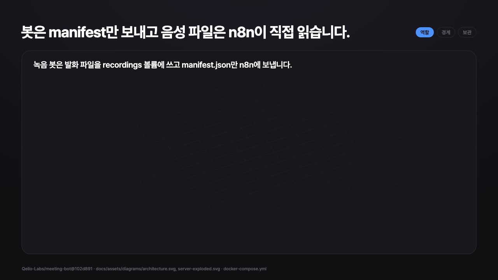
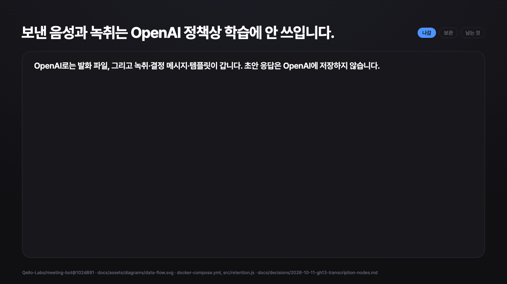
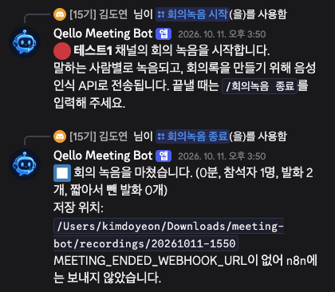
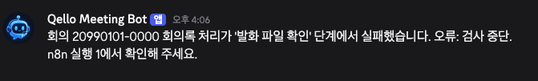
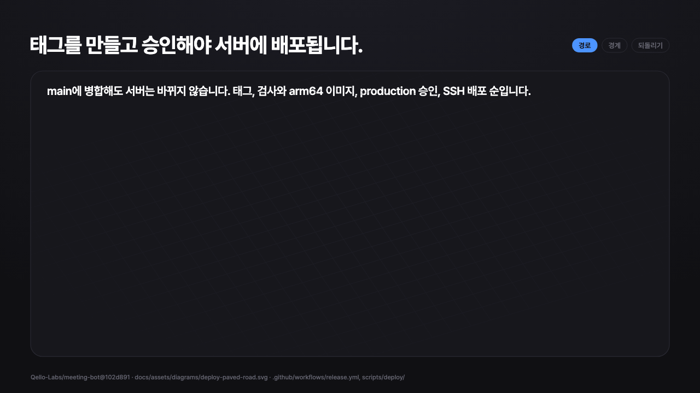

안녕하세요. `깃돌`입니다.

저희 팀은 **Discord**에서 일주일에 두 번 회의를 합니다. 회의가 끝나면 누군가 ClickUp의 회의록 템플릿을 열고 회의 내용을 정리합니다. 결정이 회의 중에만 나오지는 않습니다. 회의와 회의 사이에 채팅으로 정한 일도 누군가 옮겨 적어야 회의록에 남습니다. 기존 수동 작성 소요 평균 시간은 `약 15분`이였습니다. 너무너무 귀찮은 과정입니다.🫤  회의도 힘든데 문서도 정리해야 한다니...

이 일을 **n8n 워크플로**로 옮겼습니다. 회의를 마치며 `/회의녹음 종료`를 입력하면 `음성 인식`, `음성 회의외 결정한 메시지 수집`, `LLM 초안 작성`, `근거 매핑 및 검증`을 거쳐 회의 Discord 채널에 회의록 초안이 올라옵니다. 팀원이 버튼으로 승인한 초안만 **ClickUp 회의록** 서브 페이지에 API를 통해 기록됩니다.


---
## 회의록을 작성하는 일

회의록 템플릿은 `##` 제목 여섯 개(안건, 논의 내용, 결정 사항, 액션 아이템, 다음 회의, 기타)와 필드 네 개(일시, 회의 종류, 참석자, 관련 명세 ID)로 되어 있습니다. 기존 회의록 다섯 편의 길이는`1,070자`에서 `2,985자` 사이였습니다. 한 편의 회의록을 쓰기위해 걸린 시간은 평균 `약 15분`이었습니다.

자동화를 시작하기 전에 정한 조건은 다섯 가지입니다.

- `/회의녹음 종료` 한 번으로 **녹취**, **결정 메시지 목록**, **회의록 초안**까지 사람 손을 거치지 않고 만들어져야 합니다.
- 초안은 회의 채널에서 승인, 수정, 거절할 수 있어야 합니다. 승인한 초안만 ClickUp에 기록하고 기록한 뒤에는 다시 읽어 비교합니다.
- 회의 사이 채팅에서 ✅ 반응을 단 결정도 다음 회의록에 들어가야 합니다.
- 결정마다 **근거(녹취 시각이나 Discord 메시지 링크)** 를 달아야 합니다. 입력에 없는 근거가 있으면 기록하기 전에 멈춥니다.
- 어느 단계에서 실패하든 회의 채널에 **알림**이 와야 합니다.

운영에서 측정할 지표도 함께 정했습니다. `회의록 작성 시간 전후`, `채팅 결정 누락 건수`, `근거 검증에서 멈춘 초안 수`, `승인과 수정과 거절 비율`, `회의당 API 비용`입니다.

---
## 스크립트 대신 n8n을 선택한 이유

처음 설계할 때는 `n8n`이 필요 없다고 생각했습니다. 첫 범위는 **Discord 스레드 채팅의 결정 메시지를 회의록으로 옮기는 것**이었고 이 정도는 **스크립트**와 **GitHub Actions**로 충분했습니다.

**음성 인식**과 **사람의 승인**이 요구에 들어오면서 결정이 달라졌습니다. 승인을 며칠씩 기다렸다가 이어 가야 했고 외부 API 호출이 실패하면 다시 시도해야 했습니다. 회의마다 무엇이 들어오고 나갔는지 볼 실행 기록과 화면에서 프롬프트를 고칠 방법도 필요했습니다.

`n8n`은 이 기능을 기본으로 갖고 있습니다. 예를 들어 Wait 노드는 실행을 멈출 때 실행 데이터를 데이터베이스에 내려 둡니다. 정해진 주소로 호출이 오면 멈춘 부분부터 이어간다고 명시되어있습니다 [[1]](https://docs.n8n.io/integrations/builtin/core-nodes/n8n-nodes-base.wait/).

`n8n`을 처음부터 고려하지는 않았습니다. 요구가 커지면서 맞는 도구가 바뀌었습니다. 물론 단점도 있었습니다. `n8n`에서 Git 연동(Source control)은 Business와 Enterprise 플랜 기능(즉, 월마다 돈을 내라는 뜻 ㅜㅜ)이고 직접 운영하는 n8n에서는 자격 증명 공유도 같은 플랜에서만 쓸 수 있습니다. 워크플로는 테스트하기도 어렵습니다. 그래서 틀리면 안 되는 검증은 **Code 노드**로 분리했습니다.

프로세스가 고정되어 있다는 점도 설계 판단에 큰 영향을 주었습니다. 회의록 작성은 수집, 요약, 검증, 승인, 기록이라는 명확한 순서를 따르며, 거쳐야 할 단계 수도 사전에 정의되어 있습니다.

Anthropic의 아티클 'Building effective agents'에서는 워크플로를 다음과 같이 정의합니다. [[2]](https://www.anthropic.com/engineering/building-effective-agents).

> Workflows are systems where LLMs and tools are orchestrated through predefined code paths.

반면 에이전트는 LLM이 스스로 실행 과정과 도구 사용을 결정하며 단계 수를 예측하기 어려운 오픈 엔디드(Open-ended) 문제에 적합하다고 설명합니다. 

이러한 관점에서 볼 때, 회의록 작성 자동화는 동적인 에이전트보다는 정형화된`워크플로`로 구현하는 것이 타당합니다. 회의록 작성은 워크플로 쪽에 가깝습니다. 그래서 **LLM**에게는 템플릿을 채우는 일 하나만 맡기고 나머지 순서는 **노드**로 고정했습니다.

---
## 전체 구조




녹음 봇과 n8n 워크플로우가 단일 서버의 Docker Compose 환경에서 함께 돌아갑니다.

| 구성 요소 | 맡은 일 |
| --- | --- |
| 녹음 봇 (Node.js, Docker) | `/회의녹음 시작`부터 `종료`까지 참석자별 발화를 파일로 저장합니다. 회의가 끝나면 manifest를 n8n에 보냅니다. 승인 버튼 클릭을 받아 n8n에 전달하는 일도 맡습니다 |
| n8n 2.42.6 (Docker) | 회의 녹취 워크플로(노드 40개)와 회의 녹취 실패 알림 워크플로(노드 6개)를 실행합니다 |
| OpenAI API | 음성 인식(gpt-4o-transcribe)과 회의록 초안(gpt-6-luna)을 맡습니다 |
| Discord API | 결정 메시지 조회, 초안 메시지와 버튼, 결과 표시에 씁니다 |
| ClickUp API | 템플릿 읽기, 회의록 페이지 쓰기와 다시 읽기에 씁니다 |

**n8n**은 노드를 이어 붙여 데이터 흐름을 만드는 **오케스트레이션 엔진**입니다. 노드 하나가 HTTP 요청, 파일 읽기, JS 실행 등의 단위 작업을 처리하며 노드 사이로 JSON 아이템이 전달됩니다.

아키텍처 설계 시 반영한 보안 및 격리 원칙 세 가지는 다음과 같습니다.

> 1. **외부 노출 최소화**: n8n은 외부에 직접 노출하지 않습니다. 서버 인바운드는 SSH(22번 포트)만 열어두고 n8n은 127.0.0.1:5678로 바인딩했습니다. 관리자 화면은 SSH 포트 포워딩으로 접속합니다. 따라서 Discord 승인 버튼 클릭 이벤트는 녹음 봇이 Discord Gateway로 받아 Docker 내부 네트워크를 통해 n8n으로 넘겨줍니다.
> 2. **볼륨 접근 제한**: 녹음 파일은 녹음 봇만 쓰도록 격리했습니다. n8n 컨테이너에는 녹음 디렉터리를 읽기 전용(Read-only)으로 마운트하고 File 노드가 허가되지 않은 경로를 찌르지 못하도록 N8N_RESTRICT_FILE_ACCESS_TO=/recordings 환경변수를 강제했습니다.
> 3. **민감 데이터 격리**: 녹취나 채팅 원문 데이터는 n8n 실행 이력(Execution Data) 내부에서만 다룹니다. Discord 알림 채널에는 '녹취 완료, 발화 N개' 수준의 메타데이터만 노출합니다.


---
## 초기 설계에서 달라진 점


초안은 Claude Messages API가 작성하고, 진행자가 SSH 포워딩으로 n8n에 들어와 수동 승인하는 구조였습니다.
초기 구상과 지금의 최종 구조는 크게 `두 가지`가 달라졌습니다. 처음에는 진행자 한 명이 **SSH**를 통해 **n8n 웹 화면**에서 승인 버튼을 눌렀고 초안 작성 모델로는 **Claude**를 고려했습니다. 하지만 지금은 팀원 누구나 Discord 채널에서 버튼 하나로 승인할 수 있고 초안 모델도 음성 인식과 **동일한 OpenAI**로 통일했습니다. 승인 방식은 UX 개선 과정에서 모델은 뒤에서 다룰 비용 및 인프라 통합 이슈로 변경했습니다.


---

## 데이터 LifeCycle




**녹음 파일**과 **manifest**는 서버 디렉터리에 보존되며 7일 뒤 자동으로 삭제됩니다. 녹취록, 채팅 원문, 초안이 남는 n8n 실행 이력은 `168시간(7일)` 동안 유지됩니다. 승인 대기 유효기간이 `3일`이므로, 승인이 거절되거나 밀린 회의도 일주일 안에는 언제든 다시 추적할 수 있습니다. ClickUp에는 최종 승인된 회의록만 저장됩니다.

**녹음 봇**은 음성 채널 입출력 시 **_"화자별로 음성이 녹음되며, 회의록 생성을 위해 STT API로 전송됩니다"_** 라는 안내를 띄웁니다. OpenAI API로 넘어간 데이터는 기본적으로 모델 학습에 활용되지 않습니다[[3]](https://developers.openai.com/api/docs/guides/your-data). Responses API의 경우 별도 지정이 없으면 응답을 **30일간** 보관하므로, 초안 생성 요청 헤더에 `store: false` 옵션을 명시적으로 넣었습니다 (단, 시스템 모니터링용 로그는 최대 30일간 보관될 수 있습니다).

---

## 노드 40개를 4개의 묶음으로
메인 회의 워크플로우는 총 40개의 노드로 구성되어 있습니다.


실선은 `정상` 흐름, 점선은 `예외/수정/종료` 분기입니다.
역할에 따라 크게 네 파트로 나뉩니다.

> 1. 녹취 및 결정 수집 11개
> 2. AI 초안 생성 및 Discord 전송 10개
> 3. 승인/수정 핸들러 9개
> 4. ClickUp 저장 및 결과 대조 10개

이 노드들을 한꺼번에 구축한 것은 아닙니다. 여러 단계를 하나씩 얹어가며 개발했습니다. 매 단계마다 **n8n 컨테이너**에`OpenAI`, `Discord`, `ClickUp의 Mock 서버`를 붙여 **E2E 테스트**를 수행했고 실제 운영 API로도 검증했습니다.

| 순서 | 더한 기능 | 노드 수 | E2E 테스트 | 실제 서비스 확인 |
| --- | --- | --- | --- | --- |
| 1 | 녹음 정보 수신, 발화 파일 읽기, 음성 인식, 녹취, 알림 | 8 | 5회 | 음성 인식 3회 |
| 2 | 결정 메시지 수집, 두 갈래와 Merge | 13 | 7회 | Discord 조회 1회 |
| 3 | 템플릿 읽기, 초안 작성, 근거 검증 | 17 | 11회 | 초안 작성 1회 |
| 4 | 초안 메시지, 승인과 거절 버튼, 승인 대기 | 26 | 12회 | 승인, 거절 각 1회 |
| 5 | 수정 버튼, ClickUp 쓰기와 대조 | 40 | 13회 | ClickUp 기록 2회 |
| 6 | 실패 알림 워크플로, 릴리스 때 워크플로 자동 반영 | 40 + 6 | 회의 녹취 15회, 실패 알림 9회 | 서버에서 확인 |

노드 수가 `8개`에서 `40개`로 늘어나는 동안 E2E 테스트 횟수도 `5회`에서 `15회`까지 늘려가며 안정성을 확보하고자 했습니다.

---

### Part1: 녹취 및 결정 메시지 수집
#### 녹음 봇과 Manifast
녹음 봇은 회의 중에만 동작하는 커스텀 봇입니다. **Discord**는 음성 채널 입출력 시 유저별 오디오 스트림을 독립적으로 제공해주므로 별도의 화자 분리(Diarization) 모델을 돌릴 필요가 없습니다. `1초` 이상 무음이 이어지면 발화 하나가 끝난 것으로 보며 `0.7초` 미만의 자잘한 노이즈성 발화는 버립니다. 음성 파일은 별도 재인코딩 없이 **webm 컨테이너**로 감싸 저장하는데 이는 **OpenAI STT API** 가 지원하는 포맷 규격에 맞추기 위함입니다.



녹음 봇과 n8n 워크플로 사이의 인터페이스는 `manifest.json` 파일 하나입니다. 회의가 끝나면 봇이 **음성 파일**과 **manifest**를 디렉터리에 쓰고 **n8n의 Webhook 노드**를 호출합니다.
```json
{
  "meetingId": "20261014-1400",
  "guildId": "<서버 ID>",
  "textChannelId": "<회의 채널 ID>",
  "startedAt": "<ISO 시각>",
  "participants": ["…"],
  "segments": [{ "file": "<9자리 숫자>-<사용자 ID>.webm", "speaker": "…", "startMs": 3000, "endMs": 5200 }],
  "gaps": [{ "startMs": 20000, "endMs": 32000, "reason": "음성 연결 끊김" }]
}
```

**n8n의 Webhook 노드**는 manifest 수신 즉시 `200 OK`를 응답합니다. STT 작업에 몇 분이 걸리더라도 녹음 봇의 **HTTP 커넥션**이 **타임아웃**으로 터지지 않게 하기 위해서입니다. 응답 이후 발생하는 오류는 별도의 **실패 알림 워크플로**가 감지합니다.

```javascript
if (!isObject(manifest)) throw new Error('manifest가 JSON 객체가 아닙니다');
if (!/^\d{8}-\d{4}$/.test(manifest.meetingId ?? '')) errors.push('meetingId 형식이 다릅니다');
if (!/^\d{17,20}$/.test(manifest.guildId ?? '')) errors.push('guildId 형식이 다릅니다');
if (!/^\d{17,20}$/.test(manifest.textChannelId ?? '')) errors.push('textChannelId 형식이 다릅니다');
// 파일 이름: /^\d{9}-\d+\.webm$/ , 중복 금지, startMs ≤ endMs
```

보안상 에러 메시지에는 입력받은 실제 값을 노출하지 않습니다. 테스트 중 `meetingId`에 `../` 같은 디렉터리 트래버스 문자를 넣었을 때 첫 노드의 정규식 검증에서 바로 예외가 터져 외부 API 요청이 단 한 건도 발생하지 않음을 확인했습니다.


#### 파일 Read 노드의 맹점과 보완
**n8n**의 **Read File 노드**는 `glob 패턴`으로 파일을 읽는데, 테스트 도중 디렉터리가 비어있거나 특정 파일 하나가 누락되어도 에러를 던지지 않고 아이템 0개를 내뱉으며 성공 처리되는 문제가 있었습니다. 이대로 두면 뒤쪽 노드가 아무 일도 안 하고 정상 종료되어 버리는 문제가 있을 수 있습니다.

이를 막기 위해 파일 읽기 노드 바로 뒤에 `Code 노드('발화 파일 확인')`를 배치해 기대했던 파일 목록과 실제 로드된 파일의 개수, 순서를 일대일로 대조하도록 만들었습니다.

```javascript
const expected = $('발화 목록').all().map((item) => item.json.file);
const files = $input.all().filter((item) => item.binary?.data);
if (files.length !== expected.length) {
  throw new Error(`발화 파일 ${expected.length}개 중 ${files.length}개만 읽었습니다. 녹음 폴더를 확인해 주세요`);
}
// 음성 인식 결과를 발화 순서로 맞추므로 읽은 순서도 같아야 함
const misplaced = files.findIndex((item, i) => item.binary.data.fileName !== expected[i]);
if (misplaced !== -1) throw new Error(`${misplaced + 1}번째 발화 파일이 발화 목록과 다릅니다`);
```

#### STT 노드 선택
STT는 HTTP Request 노드를 이용해 **OpenAI API**를 직접 호출합니다.
```javascript
{ method: 'POST', url: `${openaiBase}/audio/transcriptions`,
  authentication: 'predefinedCredentialType', nodeCredentialType: 'openAiApi',
  contentType: 'multipart-form-data',
  bodyParameters: { parameters: [
    { parameterType: 'formBinaryData', name: 'file', inputDataFieldName: 'data' },
    { name: 'model', value: 'gpt-4o-transcribe' }, { name: 'language', value: 'ko' },
    { name: 'prompt', value: "={{ $('녹음 정보 확인').first().json.prompt }}" } ] },
  options: { batching: { batch: { batchSize: 5, batchInterval: 500 } }, timeout: 120000 } }
// + retryOnFail: true, maxTries: 3, waitBetweenTries: 5000
```

발화 파일마다 요청을 보내는데 5개씩 묶어(Batch) 보내고 묶음 사이에 `0.5초`의 딜레이를 두었습니다. 고유명사나 참석자 이름이 튀는 걸 막기 위해 **프롬프트**도 함께 넘겨줍니다.

중간에 이 노드를 **n8n**이 제공하는 **빌트인 OpenAI 노드**로 교체했다가 다시 HTTP Request 노드로 원복한 일이 있었습니다. **빌트인 노드**는 내부 코드를 까보니 모델이 `whisper-1`로 강제 고정되어 있었고 **프롬프트 옵션**도 사용할 수 없었습니다. 실제 동일한 녹음 데이터(발화 10개, 약 1분 분량)로 두 방식을 비교해 보았습니다.

| 구성 | 처리 시간 | 녹취 줄 수 | 한 줄 평균 길이 | 지어낸 문구로 의심되는 줄 |
| --- | --- | --- | --- | --- |
| HTTP Request + gpt-4o-transcribe | 4.2초 | 13 | 12자 | 0 |
| 전용 노드 + whisper-1 | 16.6초 | 13 | 25자 | 1 |
| HTTP Request + gpt-4o-transcribe (되돌린 뒤) | 3.0초 | 13 | 12자 | 0 |

분석 결과, 대다수의 서드파티 노드가 파라미터 제약이 커서 결국 HTTP Request 노드로 돌아오게 되었습니다.
| 노드 | 코드에서 확인한 것 | 결정 |
| --- | --- | --- |
| OpenAI STT | 모델이 `whisper-1`로 고정됨, 프롬프트 미지원 | HTTP Request |
| OpenAI Responses | Reasoning effort 선택지가 제약됨, `store` 옵션 기본값이 true | HTTP Request |
| Anthropic | `max_tokens`, `system`, `temperature` 등 기본 파라미터만 지원 | HTTP Request |
| Discord 메시지 조회 | 채널 전체를 다 긁어오거나, 최신 100개 제한이라 과거 결정 누락 위험 | HTTP Request |
| Discord 메시지 보내기 | 멘션 제어 옵션(allowed_mentions) 미지원 | 코드가 만든 숫자만 담는 알림에만 사용 |
| ClickUp | 문서(Docs) 관련 API 미지원 | HTTP Request |


#### 녹취록 타임라인 렌더링
'녹취 만들기' 노드는 변환된 **발화 데이터**와 **네트워크 끊김 구간 메타데이터**를 모아 하나의 시간축으로 정렬합니다. 각 줄 앞에 붙는 `[HH:MM:SS]` 타임스탬프는 회의 시작 시점부터 경과한 시간이며 나중에 LLM이 생성한 결정 사항의 출처를 검증하는 **핵심 키**가 됩니다.
```text
[00:00:03] 참석자 2: …
[00:00:20] (녹음 끊김 약 12초, 음성 연결 끊김)
[01:02:05] 참석자 1: …
```

#### **비동기 채팅 결정 수집 (Discord Snowflake 계산)**

회의 사이의 스레드나 채팅으로 정해진 결정 사항도 가지고와야 합니다. 수집 범위는 **직전 회의록 작성이 완료된 시점** 부터 **이번 회의 종료 시점** 까지입니다. 최근 N일 동안의 메시지를 가지고 오는 식으로 짜면 회의 주기에 따라 중복이나 누락이 필연적으로 발생합니다.  

수집 기준 시각은 `n8n`의 **Static Data**에 저장해두고 ClickUp 최종 기록에 성공한 순간에만 업데이트합니다. **승인이 거절된 회의의 결정 사항**은 버려지지 않고 다음 회의록 수집 대상에 그대로 남게 됩니다.  

**Discord API** 규격에 맞춰 시작/종료 시각을 `BigInt` 기반의 **Snowflake ID**로 변환하여 API 조건절(before, after)에 넣어 요청합니다.

```javascript
const idAt \= (ms) \=\> (BigInt(ms) \- DISCORD\_EPOCH) \<\< 22n;   // DISCORD\_EPOCH \= 1420070400000n  
afterId: (idAt(fromMs \+ 1) \- 1n).toString(),   // 시작 시점 이후 메시지  
endId:   (idAt(endedMs \+ 1) \- 1n).toString(),  // 회의 종료 시점 이전 메시지
```

메시지 수집은 `n8n` HTTP Request 노드의 Pagination 기능으로 처리합니다. 100개 단위로 가져오며, 가져온 메시지 중 가장 큰 ID를 다음 after 값으로 갱신합니다. 메시지가 사람 손으로 작성된 일반 메시지나 답장 형태이면서 **✅ 리액션이 1개 이상 달린 건**만 필터링합니다.

---

### Part02: AI 초안 작성 및 Discord 전달

#### 템플릿 처리 및 프롬프트 인젝션 방어

ClickUp 템플릿은 가변성을 위해 워크플로 실행 시마다 API로 실시간 호출해 읽어옵니다. `LLM`에 전달할 때는 **프롬프트 인젝션**이나 **데이터 오염**을 막기 위해 `템플릿`, `녹취록`, `채팅 결정 메시지 데이터`를 각각 커스텀 태그(`<meeting\>`, `<template\>`, `<transcript\>`, `<decision\_messages\>`)로 엄격하게 감싸고 **지시문**은 맨 마지막에 배치했습니다. 데이터 내부에서 닫는 태그(`</...\>`)가 포함되어 넘어오는 경우를 대비해 텍스트 내의 `\<` 문자는 치환 처리했습니다.

```javascript  
const TAGS \= \['meeting', 'template', 'transcript', 'decision\_messages'\];  
const tagPattern \= new RegExp(\`\<(/?(?:\${TAGS.join('|')})\\\\b)\`, 'gi');  
const data \= (text) \=\> String(text).replace(tagPattern, '\<\$1');  
const wrap \= (tag, text) \=\> \`\<\${tag}\>\\n\${data(text)}\\n\</\${tag}\>\`;
```

#### LLM 모델 전환
초안 생성 모델은 `claude-sonnet-5.5`로 개발을 시작했으나, 첫 파이프라인 연동 테스트 중 `Anthropic` 계정의 잔액 부족(Credit 400)으로 작업이 중단되는 상황을 맞았습니다. 이미 STT 쪽에서 OpenAI 연동을 사용하고 있었으므로 **관리 크레딧 단일화**를 위해 초안 작성 모델도 `OpenAI` 라인업으로 변경했습니다.

| 모델 후보 | 1M 토큰 당 입력/출력 단가 | 회의당 추정 비용 | 비고 |
| :---- | :---- | :---- | :---- |
| Claude Sonnet 5.5 | \$2 / \$10 | 약 \$0.15 | 서드파티 제공자 이원화 문제로 제외 |
| gpt-6-astra | \$10 / \$50 | 약 $0.5~$1.8 | 단가 부담으로 제외 |
| gpt-6.1-sol | \$2 / \$10 | 약 $0.1~$0.4 | 성능은 우수하나 단순 요약 대비 과스펙 |
| **gpt-6-luna** | **\$0.10 / \$0.50** | **약 \$0.02** | **최종 선택 (가성비 최적)** |

`gpt-6-luna` 같은 경량 모델은 LLM 출력 형식을 이탈할 확률이 높지만 어차피 후속 Code 노드에서 엄격한 형태 검증을 돌려 차단하기 때문에 모델 단가를 극단적으로 낮추는 선택을 했습니다.

```javascript  
request: {  
  model: 'gpt-6-luna',  
  reasoning: { effort: 'high' },  
  max\_output\_tokens: 32000,  
  store: false,  
  instructions,  
  input: \[{ role: 'user', content: user }\],  
}
```

#### 코드 기반의 엄격한 근거 검증(Validation)
`LLM`이 생성해낸 초안은 ClickUp에 쓰이기 전, '초안 검증' Code 노드를 통과해야 합니다. 이 노드는 다음 6가지 규칙을 검사합니다.



> 1. **템플릿 구조**: \#\# 헤더, 필드 표, 액션 아이템 테이블 형태가 원본 템플릿과 일치하는가  
> 2. **근거 규격**: 모든 결정 사항이 
 \<결정\>. 이유: \<이유\>. (근거: 녹취 HH:MM:SS, \[Discord 메시지\](\<링크\>)) 포맷을 준수하는가  
> 3. **타임스탬프 실존 여부**: 근거에 적힌 녹취 시각이 실제 녹취록의 \[HH:MM:SS\]에 존재하는가  
> 4. **링크 유효성**: 근거 링크가 수집 단계에서 넘겨준 Discord 메시지 URL과 일치하는가  
> 5. **결정 사항 누락 여부**: ✅가 달렸던 수집 메시지가 초안 작성 시 하나라도 누락되지 않았는가  
> 6. **플레이스홀더 잔재**: \<…\> 형태의 미완성 문자열이 남아있지 않은가

---

### Part03: 승인 및 수정 핸들러

#### Discord 버튼 기반의 Human-in-the-Loop

**Discord** 메시지 본문은 `2,000자` 제한이 있지만 **Embed Description**은 `4,096자`까지 지원합니다. 작성된 회의록 초안은 **Discord Embed **형태로 채널에 게시됩니다.

* Embed 하단에는 **\[승인\]**, **\[수정\]**, **\[거절\]** 3가지 버튼이 존재합니다. (수정 모달 입력창 한도가 4,000자이므로, 초안이 4,000자 이하일 때만 수정 버튼이 활성화됩니다\[11\].)  
* 초안이 4,096자를 초과하면 Embed에는 앞부분만 노출하고 전체 텍스트는 `.md` 파일로 첨부합니다.



#### **Wait 노드 재개 주소와 서명 보안**

`n8n`의 **Wait 노드**가 대기 상태에 들어가면 고유한 재개 URL(\$execution.resumeUrl)을 생성합니다. 이 URL 내부에는 단순 **Execution ID**뿐만 아니라 64자리 인증 **서명 파라미터**가 포함됩니다.  
녹음 봇이 `n8n`을 재개하려면 이 서명이 필요합니다. 보안과 세션 관리를 위해 이 정보를 Discord 커스텀 버튼 ID (custom\_id) 내부에 포함시키는 방식을 채택했습니다.

* 버튼 ID 구조: mb:\<approve|reject|edit\>:\<executionId\>:\<revision\>:\<signature\>

Wait 노드의 대기 유효기간은 `3일`로 설정했습니다. `3일` 동안 반응이 없으면 **타임아웃**으로 세션이 종료되며 초안 메시지 스레드에 만료 알림 댓글이 달립니다. 

```javascript
JavaScript  
// n8n 결정 읽기 노드 내부  
const current \= (\$('수정 반영 만들기').isExecuted 
  ? \$('수정 반영 만들기') : \$('초안 메시지 만들기')).first().json;
```

팀원이 **\[수정\]** 버튼을 눌러 모달에서 내용을 고쳐 제출하면, 고쳐진 초안은 버전 리비전(rev)을 1 올린 뒤 **동일한 근거 검증 노드**를 다시 거칩니다. 사람이 직접 수정한 글이라도 근거 포맷이나 타임스탬프 규칙을 어기면 승인 단계로 넘어갈 수 없게 설계했습니다. 

---

### Part04: ClickUp 저장 및 대조 검증
`승인(Approve)` 상태가 확인되면 '쓰기 준비' 노드가 실행됩니다. 문서 제목은 \${YYYY-MM-DD} 정기 회의 규칙을 따르며, 본문 텍스트는 ClickUp의 Markdown 파서 특성에 맞게 일부 이스케이프 포맷팅을 다듬어줍니다.

```javascript
let line \= raw.replace(/(?\<\!\\\\)\~/g, '\\\\\~').replace(/\\\*\\\*“(\[^”\\n\]\*)”\\\*\\\*/g, '“\*\*\$1\*\*”');  
if (/^\\s\*\\|/.test(line)) line \= line.replace(/\\\*\\\*(.+?)\\\*\\\*/g, '\$1');   // 표 셀 내부 bold 태그 정리  
if (/^\\s\*1\\.\\s/.test(line) && prev \!== undefined && prev.trim() \!== '') out.push('');  
if (/^\\s\*\>/.test(line) && next && next.trim() \!== '' && \!/^\\s\*\>/.test(next)) out.push('');
```

ClickUp API 전송 프로세스는 다음과 같습니다.

> 1. **상위 페이지 조회**: target 문서의 페이지 트리를 읽어옵니다.  
> 2. **위치 검증**: 최상위 문서가 아닌, 내부 '회의록' 서브 페이지의 하위 경로로 위치를 고정합니다. (앞서 언급했듯 수집기 스펙 준수 목적)  
> 3. **중복 방지**: 동일한 이름의 페이지가 이미 존재하는지 체크합니다.  
> 4. **페이지 생성**: parent\_page\_id, name, content, content\_format: 'text/md' 조합으로 API 요청을 날립니다.  
> 5. **대조 검증 (Read-Back)**: 방금 저장된 ClickUp 페이지를 다시 API로 긁어와 원본 초안과 최장 공통 부분열(LCS) 알고리즘으로 일대일 비교합니다. 공백, 구분선, 이스케이프 차이를 제외하고 내용이 일치하는지 최종 확인합니다. 대조가 끝나면 수집 기준 시각 static data를 이번 회의 종료 시각으로 업데이트합니다.

#### 실패 감지용 서브 워크플로
메인 워크플로 설정의 errorWorkflow 항목에 '회의 녹취 실패 알림' 워크플로를 연결했습니다. `n8n`의 기본 **Error Trigger 노드**는 실행 에러 메타데이터만 넘겨줄 뿐, 실행 당시의 **노드 Context**나 **채널 ID** 같은 파라미터를 넘겨주지 않는 문제가 있었습니다. 

이를 해결하기 위해 메인 워크플로 중간중간에 `$execution.customData` 객체에 `meetingId`, `textChannelId`, `messageId` 등을 기록하도록 코드를 작성했습니다.  
**실패 알림 워크플로우**는 n8n의 Read-only API Key를 사용해 `GET /api/v1/executions/{id}?includeData=true`를 조회하고 customData를 추출해 실패가 발생한 해당 Discord 채널로 에러 리포트를 작성합니다.



#### 워크플로우를 코드로 관리하기

**n8n 캔버스(GUI)**는 편리하지만 팀 단위 작업 시 **버전 관리**와 **Code 노드 단위 테스트**가 어렵다는 단점이 있습니다. 그래서 저장소의 파일 체계를 'Single Source of Truth'으로 삼는 방식을 도입했습니다. GUI는 시각적 모니터링 및 일시적 디버깅용으로만 쓰고 원본 소스코드는 **GitHub**로 관리합니다.

* Code 노드 내 로직은 workflows/src/\*.js 파일로 개별 분리하여 관리합니다.  
* 공통 검증 함수(verifyDraft 등)는 shared/ 디렉터리에 두고 빌드 시점에 노드 스크립트 상단에 번들링 결합합니다.  
* scripts/build-workflow.js 스크립트가 JS 코드 파일들과 메타데이터를 조합해 n8n import용 최종 JSON을 생성하며, CI(npm test) 과정에서 기획된 JSON과 코드 파일 간 차이(Diff)가 없는지 검증합니다.


#### 서버 환경 및 CD 파이프라인


**Oracle Cloud A1 인스턴스(ARM64)** 단일 서버 상에서 **Docker Compose**로 녹음 봇과 **n8n**을 격리 운영합니다.  



**GitHub Actions** 승인 단계를 거쳐 `SSH` 기반 배포 스크립트를 실행합니다. 배포는 **GitHub의 Release Tag(vX.Y.Z) 이벤트**로 트리거됩니다. CI 통과 후 ARM64 Docker 이미지를 **GHCR**에 푸시하고 Production 승인을 거치면 배포 스크립트가 실행됩니다. 보안을 위해 배포용 **SSH Key**는 **authorized\_keys**의 `command=` 제약 조건을 걸어 사전 정제된 배포 스크립트만 실행할 수 있도록 제한했습니다.  
**n8n 워크플로우** 업데이트는 **n8n REST API**를 통해 이뤄집니다.

---

## 실시간 벤치마크 테스트 결과
발화 2개와 테스트 결정 메시지 2개가 포함된 시나리오로 로컬 파이프라인 전체를 돌렸을 때의 레이턴시 측정 결과입니다.

| 단계 | 소요 시간 | 비고 |
| :---- | :---- | :---- |
| STT 음성 인식 | 1.5초 | 발화 2개 기준 |
| ClickUp 템플릿 Fetch | 0.7초 |  |
| **LLM 초안 작성 (gpt-6-luna)** | **9.2초** | 입력 1,034 토큰 / 출력 970 토큰 (Reasoning 711토큰 포함) |
| 초안 근거 검증 | 0.07초 | Code 노드 내 수초 내 완료 |
| **전체 프로세스** | **약 13초** | **최종 초안 메시지 수신까지** |

전체 `13초` 중 `9초` 이상이 LLM 추론 시간이었습니다. 단가 계산 시 테스트 1회당 토큰 비용은 약 `$0.0006` 수준이었습니다.

---

## 마치며
이번 파이프라인 구축을 돌이켜보면, 노드 40개 중 실제로 LLM이 개입하는 구간은 `단 1개`의 노드뿐이었습니다. 자동화 워크플로우의 성패를 가른 진짜 핵심은 LLM 앞뒤에 배치된 **데이터 수집의 정교함**, **Deterministic한 코드 기반 검증**, **사람의 승인 대기 세션 관리**, 그리고 **외부 시스템 저장소와의 상태 대조** 같은 `오케스트레이션 설계`였습니다.  

*시스템 자동화를 고민하고 계신 분들에게 이 글의 경험이 조그만 힌트가 되었으면 합니다.* 😀